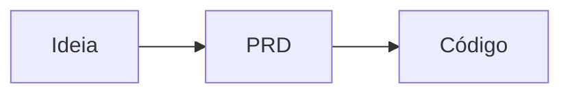

<!--
Nome do arquivo: src/content/posts/AAAA-MM-DD-assunto.md (a data sai da URL: /posts/assunto/).
Imagens: public/img/assunto/ e no texto .
Regra de ouro: "se eu ler isso daqui a 6 meses, eu entendo?"
-->

## Em uma frase

A resposta vem antes da explicação.

## Por que este assunto

O problema real, o projeto ou a escolha por trás do post.

## O que é

Com uma comparação do dia a dia. Todo termo técnico é explicado na primeira vez que aparece.

## Na prática

O que eu fiz, com código, print ou comando. Sempre com dado de mentira.

## Onde dá errado

Limites, custo e segurança.

## Para se aprofundar

Assuntos vizinhos que valem um próximo passo. Pode virar o próximo post.

## Fontes

- [Nome da fonte](https://exemplo.com), consultada em DD/MM/AAAA

## Glossário

- **Termo:** explicação em uma linha.
